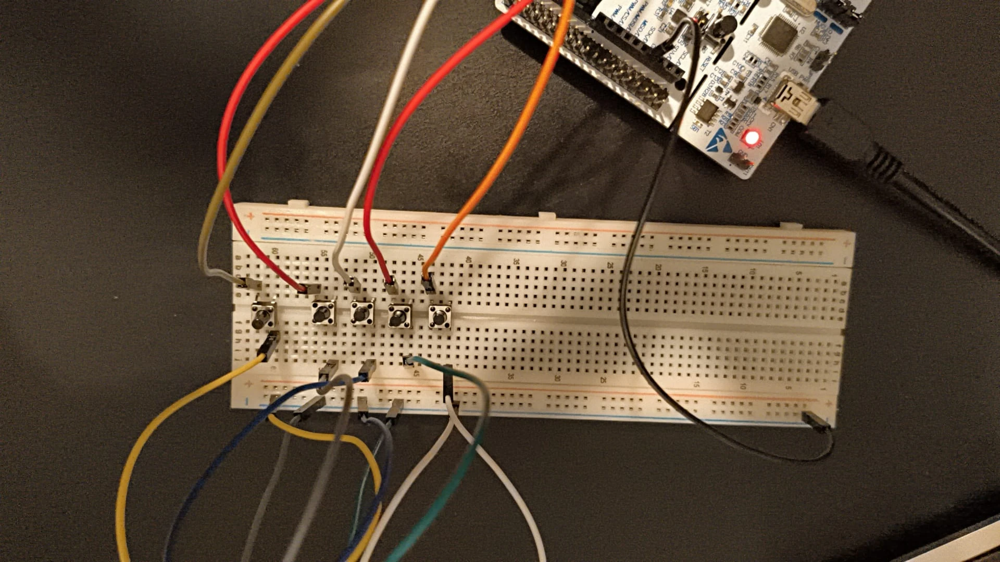
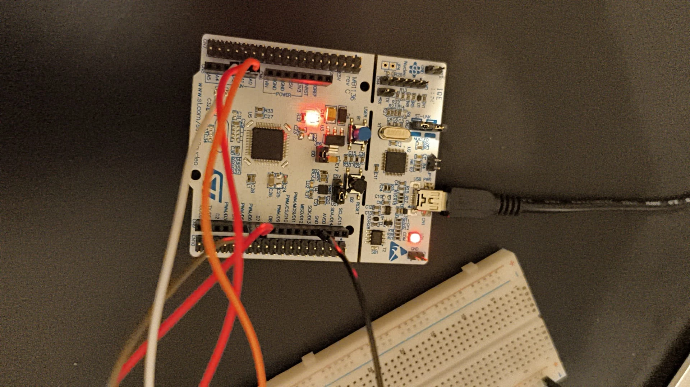
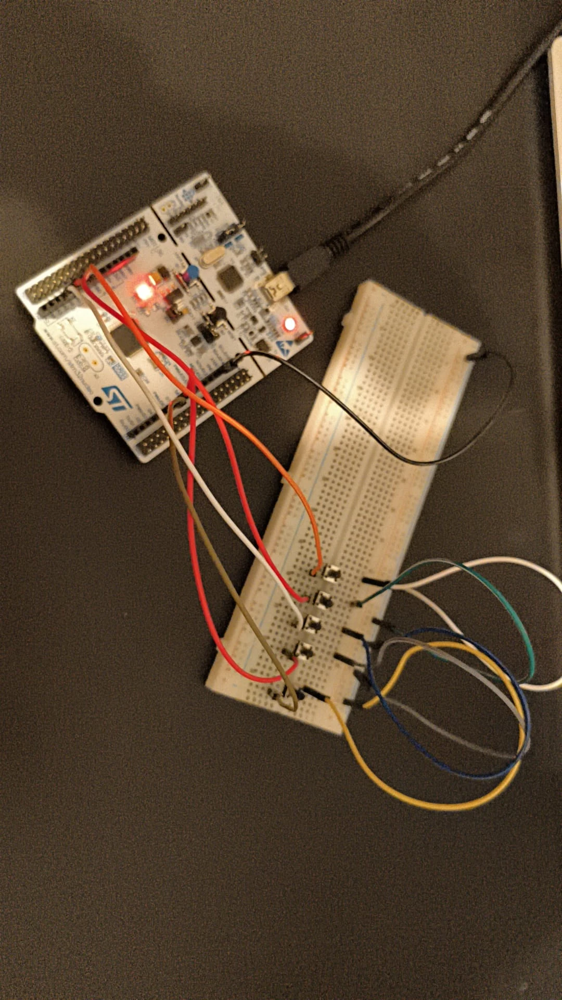

# STM32 UART Mouse

A five-button mouse built on an **STM32F401RE (NUCLEO-F401RE)**. The board scans the buttons every 10 ms, turns them into cursor movements and clicks, and sends them over UART to a small host script that moves the real mouse pointer on Windows. Speed and acceleration can be changed at runtime through a serial settings menu.

It is the first stage of a planned **assistive head mouse** (see [Roadmap](#roadmap)): the same firmware structure will later drive a USB HID mouse controlled by an IMU, for people who cannot use their hands.

<p align="center">
  
</p>

## Features

- **Five external buttons + the on-board button**: up, down, left, right, left click (external) and right click (on-board B1).
- **Acceleration**: the cursor starts slow and speeds up while a direction button is held.
- **Debounced clicks** with separate press and release events, so drag and drop works.
- **Runtime settings menu** over the serial port (max speed, start speed, acceleration), handled by a small **state machine** while the mouse keeps working.
- **Interrupt-driven UART receive** into a **ring buffer**; the main loop never blocks.
- **Host script** (`tools/fare.ps1`) with no dependencies: PowerShell plus the Windows `user32.dll` mouse API.

## Hardware

| Part | Notes |
|---|---|
| NUCLEO-F401RE | STM32F401RE, Cortex-M4 at 84 MHz |
| 5 × 6×6 mm tactile buttons | Placed across the breadboard's centre gap |
| Breadboard + jumper wires | No soldering needed, no resistors (internal pull-ups) |

### Wiring

Each button connects a GPIO pin to **GND** when pressed. The pins use the MCU's **internal pull-up**, so they read `1` when released and `0` when pressed.

| Function | Nucleo header | MCU pin | CubeMX label |
|---|---|---|---|
| Up | A0 | PA0 | `BTN_UP` |
| Down | A1 | PA1 | `BTN_DOWN` |
| Left | A2 | PA4 | `BTN_LEFT` |
| Right | D7 | PA8 | `BTN_RIGHT` |
| Left click | D6 | PB10 | `BTN_CLICK` |
| Right click | on-board blue button | PC13 | `B1` |
| GND | any GND pin → breadboard − rail | | |

The pin numbers (0, 1, 4, 8, 10) were chosen to be distinct, because on STM32 pins with the same number on different ports (e.g. PA0 and PB0) share one EXTI line. The buttons are polled, but this keeps the option of switching to interrupts later.

<p align="center">
  
  
</p>

## How it works

```
           ┌────────────── interrupts: only leave a note ───────────────┐
TIM2 (every 10 ms) ──► tick10ms++
USART2 RX (per byte) ─► rb_yaz(&rx_tampon, byte), re-arm reception
           └─────────────────────────────────────────────────────────────┘
                                   │
main loop (never blocks) ◄─────────┘
  0. drain the ring buffer → build a line → on Enter: menu state machine
  1. on every new tick (10 ms):
       • direction buttons held → "M dx dy"  (with acceleration)
       • click buttons debounced → "B L 1" / "B L 0" / "B R 1" / "B R 0"
       • LED on while a click is held
                                   │ UART 115200 8N1 over the ST-LINK virtual COM port
                                   ▼
tools/fare.ps1 (Windows) → user32 mouse_event → real cursor
```

The rule throughout the firmware: **interrupt handlers only record that something happened; all real work happens in the main loop.** This keeps the ISRs a few microseconds long and the timing predictable.

### Serial protocol (board → PC)

| Line | Meaning |
|---|---|
| `M <dx> <dy>` | Move the cursor by dx, dy pixels (y grows downwards) |
| `B L 1` / `B L 0` | Left button pressed / released |
| `B R 1` / `B R 0` | Right button pressed / released |

Any other line (menu text, start-up message) is printed by the host script.

### Settings menu (PC → board)

```
=== Ayarlar ===
1) En yuksek hiz    (simdi: 12)
2) Baslangic hizi   (simdi: 2)
3) Hizlanma (tick)  (simdi: 10)
Secim: 1
Yeni deger (1-30): 8
OK: En yuksek hiz = 8
```

(The menu text is in Turkish: max speed, start speed, acceleration.) Settings live in RAM and reset to their defaults on reboot.

## Design decisions

- **Polling instead of interrupts for the buttons.** A mouse needs to know whether a button is *held*, not just when it was pressed. Interrupts only report edges, so the buttons are sampled on a 10 ms timer tick instead.
- **Timer tick instead of `HAL_Delay`.** A blocking delay would stop the UART menu and drift over time. TIM2 (84 MHz ÷ 8400 ÷ 100 = 100 Hz) gives an exact 10 ms period, and the main loop stays free. It also prepares the code for low-power sleep (`__WFI`) between ticks.
- **Counter-based debounce.** A click is accepted only after the new state is read on two consecutive ticks (20 ms), which filters contact bounce without timestamps.
- **Ring buffer for UART RX.** Characters arrive every ~87 µs at 115200 baud, faster than the main loop can process them while it is busy printing. The ISR only appends to a 64-byte ring buffer; the main loop consumes it at its own pace. Single producer (ISR) and single consumer (main loop), each owning one index, so no locking is needed on a single-core MCU.
- **Table-driven settings.** Each setting is an entry `{name, pointer to variable, min, max}`. Adding a new setting is one line, and the menu updates itself.
- **Two-state menu (state machine).** `SECIM_BEKLE` (waiting for a choice) and `DEGER_BEKLE` (waiting for a value): the same input means different things depending on the state, and the mouse keeps running while the menu waits.

## Build and run

1. **Open the project.** In STM32CubeIDE: *File → Import → Existing Projects into Workspace* and select this folder. The pin and clock configuration is in `stm32-mouse.ioc` (STM32CubeMX 6.18).
2. **Build and flash** with the hammer and *Run* buttons.
3. **Run the host script** on Windows (close any other program using the COM port first):
   ```powershell
   powershell -ExecutionPolicy Bypass -File tools\fare.ps1            # default COM7
   powershell -ExecutionPolicy Bypass -File tools\fare.ps1 -Port COM5
   ```
   Type a number and press Enter to use the settings menu. Ctrl+C exits.

## Project structure

```
Core/Src/main.c          application code (everything inside USER CODE blocks)
Core/Src/stm32f4xx_it.c  interrupt vectors (generated)
stm32-mouse.ioc          CubeMX configuration: pins, clocks, TIM2, USART2, NVIC
tools/fare.ps1           Windows host script: serial → mouse events
docs/images/             photos of the circuit
```

Code comments are in Turkish.

## Roadmap

- [ ] **Real USB HID mouse**: use the F401's own USB pins (PA11/PA12) so the board enumerates as a mouse and the host script is no longer needed (HSE bypass clock for an exact 48 MHz USB clock).
- [ ] **IMU control (MPU6050 over I²C)**: tilt to move, with filtering and calibration, towards a head-mounted mouse for users with limited hand mobility.
- [ ] **Save settings to flash** so they survive a reset.
- [ ] **Wireless version**: STM32 → UART → ESP32-S3 → Bluetooth LE HID.
- [ ] **Low power**: sleep between ticks, Stop mode after inactivity, wake on button.
